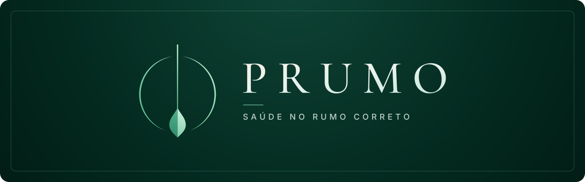
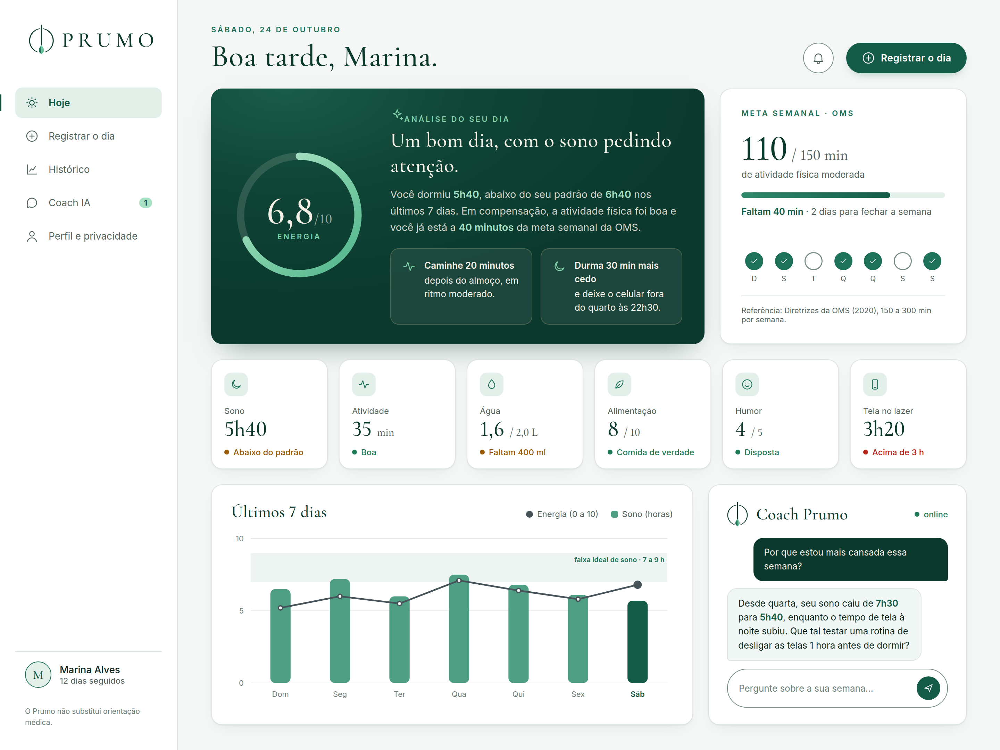
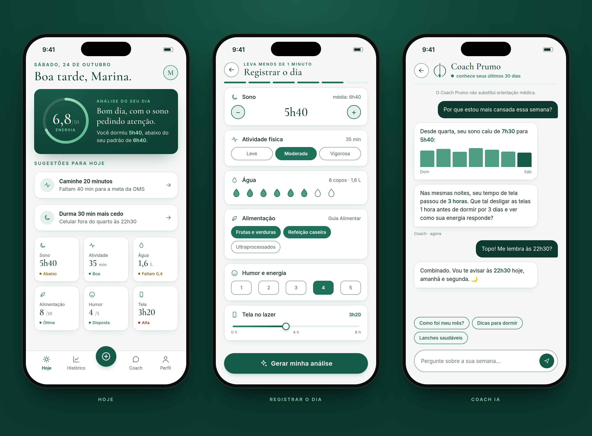

  

  <b>Um coach de bem-estar com IA que transforma os hábitos do seu dia num pequeno plano de ação.</b> 
  Projeto do <a href="https://fmu-tech-inovacao-20262.vercel.app/">FMU Tech Inovação 2026.2</a> · ODS 3: Saúde e Bem-Estar

---

### Como estou hoje?

Em menos de um minuto você registra **sono, atividade física, água, alimentação, humor e tempo de tela**. O Prumo devolve um retrato do seu dia com uma ou duas sugestões práticas, como *"caminhe 20 minutos depois do almoço"* ou *"tente dormir 30 minutos mais cedo"*.

| | |
|---|---|
| **Regras transparentes** | As notas são calculadas por código, comparando você com o seu próprio padrão dos últimos 7 dias. Os mesmos dados dão sempre o mesmo resultado. |
| **Dados públicos e reais** | Metas e médias vêm da OMS, do Guia Alimentar para a População Brasileira, do Vigitel e da PNS/IBGE. |
| **IA que explica, não inventa** | Um modelo de linguagem só transforma os números já calculados em conselhos claros e acolhedores. |
| **Privacidade em primeiro lugar** | Dados de saúde são sensíveis pela LGPD: consentimento explícito, exportação e exclusão a qualquer momento. |

  

  

### Repositórios

| Repositório | O que tem | Status |
|---|---|---|
| [**prumo**](https://github.com/Health-Prumo/prumo) | Proposta, bases de dados, identidade visual, protótipo visual e documentação da entrega | Checkpoint 1 |
| **prumo-web** | Front-end em React + TypeScript | Em breve |
| **prumo-api** | Back-end em Python, motor de pontuação e integração com a IA | Em breve |

### Stack

### Equipe

<table>
  <tr>
    <td align="center"><a href="https://github.com/Geronymow"> <b>Geronymow</b></a></td>
    <td align="center"><a href="https://github.com/Eduardokhayyam"> <b>Eduardo</b></a></td>
    <td align="center"><a href="https://github.com/gaferamos"> <b>Gabriel</b></a></td>
  </tr>
</table>

### Cronograma

| Período | Etapa |
|---|---|
| 19/10 a 30/10 | Checkpoint 1: ideação |
| 09/11 a 27/11 | Checkpoint 2: protótipo funcional |
| 07 e 08/12 | Apresentação final à banca |

---

  O Prumo não substitui orientação médica. É uma ferramenta de autopercepção e incentivo a hábitos saudáveis.

